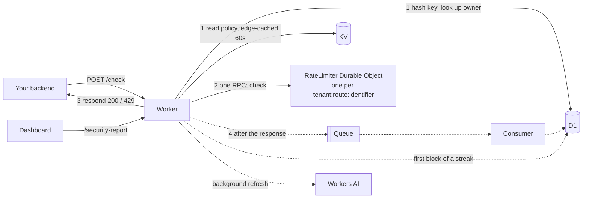
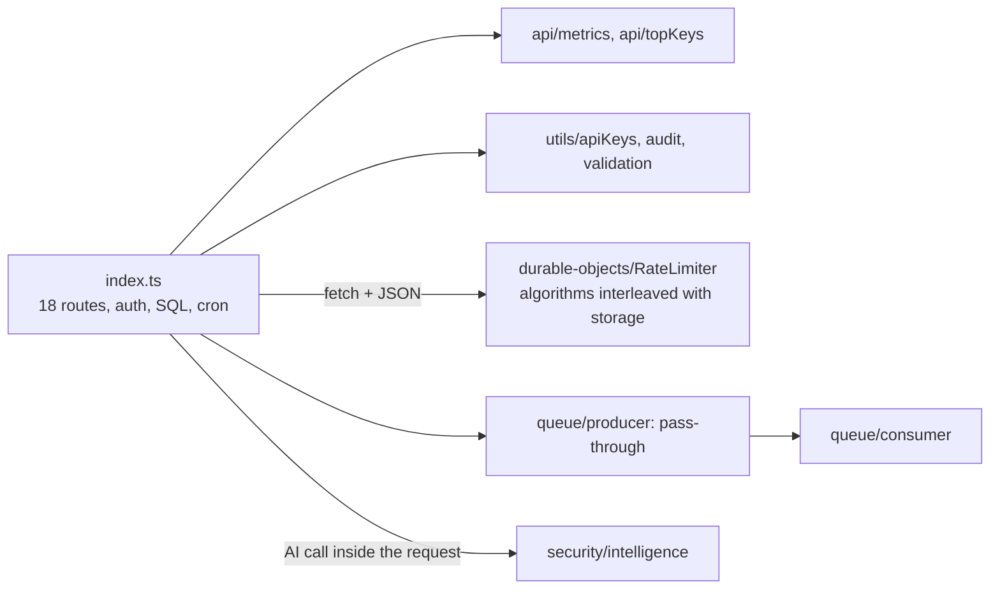

# EdgeLimiter architecture

## In one picture

Solid arrows are on the request path; dotted ones happen after the response.

## The request path

`POST /check` (`src/ratelimit/routes.ts`), in order:

1. **Validate** the body: tenant, route and optional `identifier`.
2. **Authenticate and load the policy at the same time.** The key hash is looked up in D1 while the policy is read from KV (cached at the edge for 60 s). Auth results are checked first, so a D1 failure or a bad key always wins over whatever KV returned.
3. **Decide**: one RPC to the `RateLimiter` Durable Object for this tenant, route and identifier. It loads its state, runs the pure algorithm, saves, and returns allowed, remaining and retryAfter.
4. **Respond** 200 or 429 with `X-RateLimit-*` and `Retry-After` headers.
5. **After the response** (`waitUntil`): queue a security event (Queue → consumer → D1), write one audit entry per block streak, and a data point to Analytics Engine. None of these can delay or fail the response.

Workers AI is not on any request path. `/security-report` returns the cached analysis, or the rule-based one, immediately, and refreshes the AI analysis in the background.

## Why each Cloudflare service

| Service | Used for | Why |
|---|---|---|
| Workers | API and request path | Runs close to the caller |
| Durable Objects | Counters | One single-threaded object per counter, so concurrent requests are serialized with no race and no lost update |
| KV | Policies | Read on every check, rarely written; edge-cached reads are cheap and fast |
| D1 | Users, keys, logs, audit | Relational queries, transactions for sign-up and log writes |
| Queues | Security events | Moves the D1 write off the request path; batching and retries |
| Analytics Engine | Request telemetry | High-volume write-only metrics |
| Workers AI | Threat summaries | Optional text on top of rule-based scoring |

## Code layout

Folders follow features, not technical layers. Each exposes a small interface; everything else in it is private.

| Folder | Public interface | Notes |
|---|---|---|
| `ratelimit/` | `RateLimiter`, `limiter(env, name)`, `counterName()`, `throttle()`, `rateLimitRoutes` | `algorithms.ts` is pure and has no Cloudflare imports |
| `policies/` | `readPolicy`, `savePolicy`, `listPolicies`, `deletePolicy`, `parseRule`, `parseStoredPolicy`, `policyRoutes` | KV access and policy validation |
| `keys/` | `authenticate`, `findActiveOwner`, `canAccessTenant`, `hashApiKey`, `maskApiKey`, `keyRoutes` | Sign-up, keys, access rules |
| `analytics/` | `recordCheck`, `consumeSecurityEvents`, `writeAudit`, `runDailyMaintenance`, `analyticsRoutes` | Everything written after the response, plus the reports |
| `ai/` | `getIntelligence` | Rule-based scoring, cached Workers AI summary |
| `shared/` | `Env`, `readConfig`, `log`, `readJsonObject`, `clientInfo`, `cleanString` | One config reader, one logger, one way to read bodies |
| `index.ts` | the Worker (`fetch`, `queue`, `scheduled`) | Middleware, health checks, mounts the routers |

Conventions: errors are always `{ "error": string }` with a status code; `log.info` and `log.error` write one JSON line per event; every environment variable is parsed in `shared/config.ts`.

## Trade-offs

- **Counters are strongly consistent** (one Durable Object each); **policies are eventually consistent.** A policy change can take up to about 60 s to reach every location (KV cache). Counters are never stale.
- **API keys are checked in D1 on every request, without a cache.** This is the one D1 read on the hot path. It's what makes revocation take effect on the next request; caching keys would save the read but let revoked keys keep working.
- **When something fails:**

  | Dependency down | Result |
  |---|---|
  | D1 | `/check` returns 503: it fails closed, since the caller can't be authenticated |
  | KV or Durable Object | Allowed with an `X-EdgeLimiter-Degraded` header (fail open). `RATE_LIMIT_FAIL_MODE=closed` returns 503 instead |
  | Queue, audit, Analytics Engine | Logged and ignored |
  | Workers AI | Rule-based summary |

- **Per-identifier counters** create one Durable Object per end user. An idle object deletes its own state after one window, so storage doesn't grow forever.
- **sliding_window** stores one timestamp per request, so it is capped at 10,000 per window; fixed window and token bucket are O(1).

## Adding an algorithm

1. In `src/ratelimit/algorithms.ts`, write a `Check`: `(state, { limit, windowSeconds }, nowMs) → { allowed, remaining, resetAt, state }`. Return `state: null` when nothing changed. Use new state field names; they become storage keys.
2. Add it to `ALGORITHMS` and add its new state keys to `STATE_KEYS` in `limiter.ts`. Validation, the API and the dashboard pick up the name from `ALGORITHMS` (also add a label and explanation in `dashboard/src/lib/limits.ts`).
3. Unit-test it in `test/algorithms.test.ts` (no Cloudflare runtime needed), and add a `/check` timeline in `test/behavior.test.ts`.

## What changed in the refactor

Before: a 1,689-line `index.ts` held 18 routes, auth, validation, SQL and the cron. The rest was split by technical type (`api/`, `utils/`, `queue/`, `types/`, `durable-objects/`).

| Problem | Now |
|---|---|
| God file; folders by type | Feature folders; `index.ts` is 90 lines of wiring |
| Algorithms couldn't be tested without Cloudflare | Pure `Check` functions, unit-tested directly |
| Hand-rolled JSON over `fetch` to the Durable Object, and 4 stub helpers | Typed RPC (`limiter(env, name).check(rule)`) |
| Abuse report and block-rate math copied 3× | `toMetrics` / `toAbuseReport` in `analytics/usage.ts` |
| `console.error` in every style, env parsing scattered | `shared/log.ts`, `shared/config.ts` |
| Pass-through producer module | `recordCheck` builds and queues the event itself |
| D1 auth, then KV policy read, one after the other | Run concurrently |
| Workers AI awaited inside `/security-report` | Background refresh; the response uses cache or rules |
| Validation in both the Worker and the Durable Object | Validated once, when the policy is parsed |

Local `/check` latency (Miniflare, `node scripts/bench-check.mjs 300`, p50): sliding window 3.29–4.13 ms before and 3.22–3.40 ms after; fixed window 3.02–3.28 → 3.01–3.02 ms; token bucket 2.96–3.03 → 2.90–2.94 ms. Locally D1 and KV run in-process, so running them in parallel should matter more in production.
